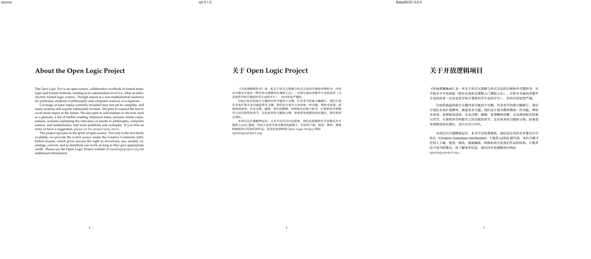
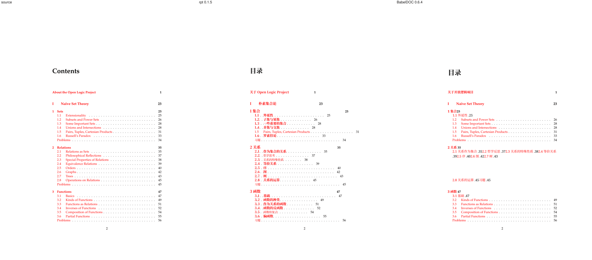
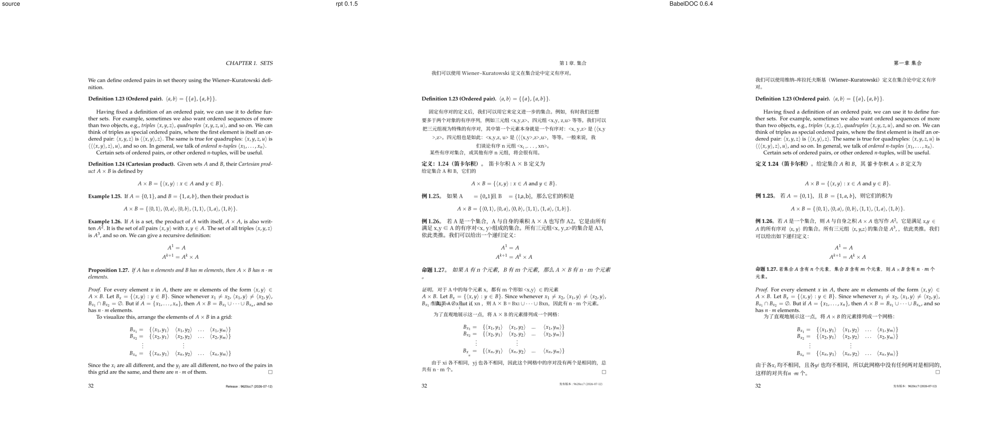
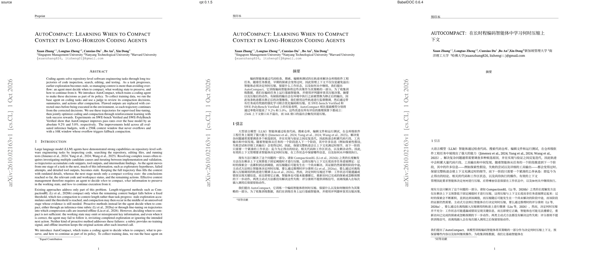
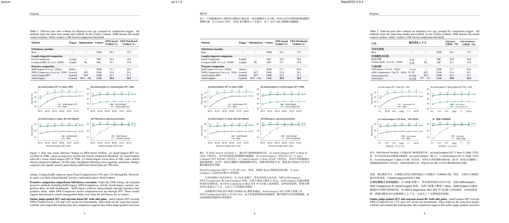
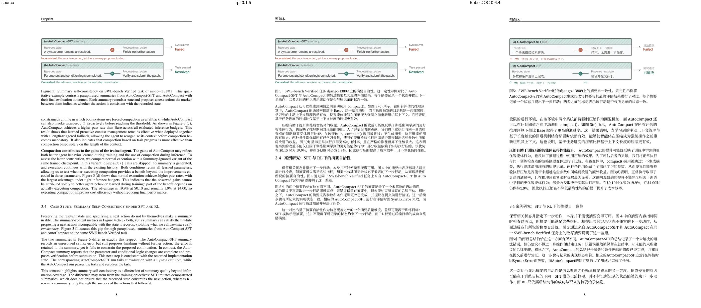
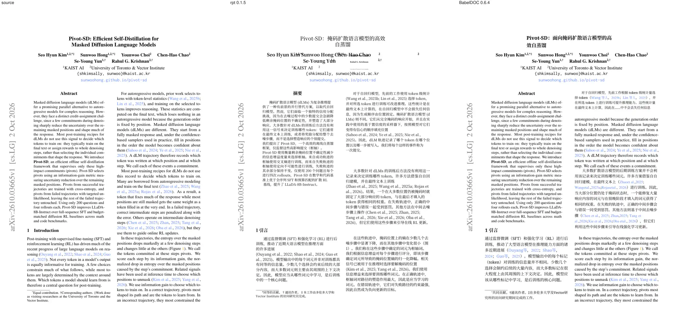
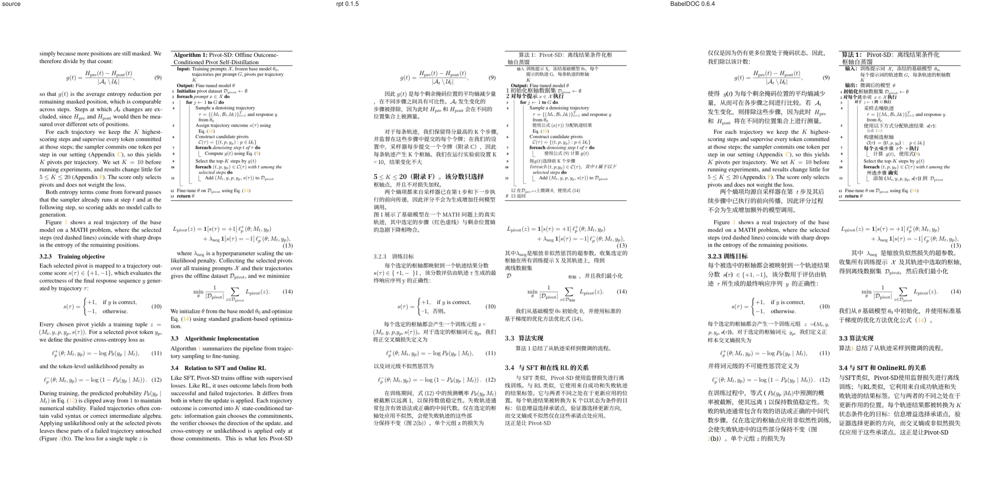
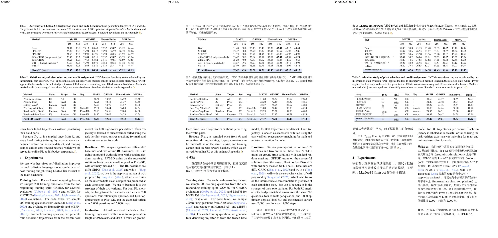

# RapidPdfTrans

Format-preserving PDF translation. The goal is to replace [BabelDOC](https://github.com/funstory-ai/BabelDOC): keep the layout, and never silently drop text.

It opens a PDF, interprets content streams down to individual glyphs, and checks that every glyph is still accounted for. A pluggable translator marks those glyphs as translated. `rpt translate` without `--output` reports that translation and does not write a file. `rpt translate --output` rewrites the glyphs into a PDF and removes the original text-showing operators for the glyphs it rewrote.

The Chinese page is [README.zh.md](README.zh.md). Wall time, peak RSS, and output size against BabelDOC are in [Live run against BabelDOC 0.6.4](#live-run-against-babeldoc-064). Page images are in [Visual comparison](#visual-comparison).

## Usage

### Install

Rust stable (1.88 or newer; the workspace pins `stable`):

```bash
cargo build -p rpt-cli --release
./target/release/rpt extract testdata/hello.pdf --compact
```

`rpt extract` prints JSON to stdout and does not write a PDF. On `testdata/hello.pdf` the plain text is `Hello` and the coverage object has `"pending": 5`.

Python (needs `python3-dev`). The module calls the Rust core directly:

```bash
cargo build -p rpt-python --release
cp target/release/librapidpdftrans.so rapidpdftrans.so
python3 -c 'import rapidpdftrans; print(rapidpdftrans.version()); print("Hello" in rapidpdftrans.extract("testdata/hello.pdf"))'
```

`rapidpdftrans.translate(path)` returns JSON and does not write a file. `rapidpdftrans.save(path, output)` writes a PDF.

C++ is a header-only wrapper over the C ABI:

```bash
cargo build -p rpt-ffi --release
g++ -std=c++17 -I include -I bindings/cpp bindings/cpp/smoke.cpp \
  target/release/librapidpdftrans.a -ldl -lm -lpthread -lgcc_s -o smoke
./smoke testdata/hello.pdf
```

`rpt::Document::extract` returns JSON. `save` writes a PDF and throws when no translator is configured and Google Translate is unreachable.

Go, from `bindings/go`, after that static library exists:

```bash
go test ./...
```

```go
text, err := rapidpdftrans.Extract("testdata/hello.pdf")
```

`Translate` returns JSON and does not write a PDF. The C function that writes a file is `rpt_save`.

### Environment

Set the key in the environment. An `api_key` field in options JSON is ignored.

| Variable | When | Default |
| --- | --- | --- |
| `RPT_LLM_API_KEY` | live LLM translation | unset |
| `RPT_LLM_BASE_URL` | optional LLM gateway | `https://hub.mypapers.top/api/llm/v1` |
| `RPT_LLM_MODEL` | optional LLM model | `auto` |
| `RPT_TRANSLATOR` | optional backend name | unset (see below) |
| `RPT_GOOGLE_API_KEY` | Cloud Translation v2 | unset |
| `RPT_GOOGLE_CREDENTIALS` | `google-v3` service account | unset |
| `RPT_GOOGLE_ACCESS_TOKEN` | `google-v3` bearer token | unset |
| `RPT_CJK_STYLE` | `serif` (Songti) or `sans` (Heiti) | `serif` |
| `RPT_CJK_FONT` | optional regular face; wins over the style | Regular of the selected family |
| `RPT_CJK_BOLD_FONT` | optional bold face; wins over the style | Bold of the selected family |
| `RPT_CJK_SANS` | optional file for regular sans source text | the regular face |
| `RPT_TRANSLATE_JOBS` | optional parallel requests | `4` (cap `8`) |
| `RPT_MAX_TRANSLATE_SECS` | optional wall-time budget for all model calls of one document | unlimited |
| `RPT_GATEWAY_DOWN_AFTER` | consecutive refusals (401/403/410/400 access denied) before no more requests are sent | `6` |
| `RPT_CJK_SIZE_SCALE` | optional | `0.90` |
| `RPT_CJK_LEADING` | optional | `1.60` |

`RPT_TRANSLATOR` is `maclaw`, `openai`, `google`, `google-v2`, `google-v3`, or `google-unofficial`. When it is unset and no `RPT_LLM_API_KEY`, `RPT_LLM_BASE_URL`, `RPT_LLM_MODEL`, `model`, or `base_url` is set, the order is: `RPT_GOOGLE_API_KEY` (Cloud Translation v2), then v3 credentials (`RPT_GOOGLE_CREDENTIALS` or `RPT_GOOGLE_ACCESS_TOKEN`), then a 3-second probe of `https://translate.googleapis.com/translate_a/single?client=gtx`. A successful probe uses that endpoint. If the probe fails, translation stops and asks for `RPT_LLM_API_KEY` or `RPT_TRANSLATOR`. An explicit translator name or LLM setting skips the probe.

### Fonts

The default Chinese face is Songti: Noto Serif CJK SC (Source Han Serif). Body text is Regular. Titles, section names, “摘要”, and other bold source faces are Bold. Heiti (Noto Sans CJK SC) is optional.

`--cjk-style serif` is the default. `--cjk-style sans` selects Heiti. The same value is the environment variable `RPT_CJK_STYLE`, and the `cjk_style` field in Python and C options JSON. The only accepted values are `sans` and `serif`.

`--cjk-font` replaces the regular face and `--cjk-bold-font` replaces the bold face. Either path wins over `--cjk-style`. `--cjk-sans` still replaces regular sans source text only, and wins over `--cjk-font` for that source style. Each path is a `.ttf`, `.otf`, or `.ttc`. Append `#N` to pick face N of a collection (`msyh.ttc#0` is a typical Microsoft YaHei face). The same strings are `RPT_CJK_FONT`, `RPT_CJK_BOLD_FONT`, and `RPT_CJK_SANS`. Python `save` / `translate` and C `rpt_save` / `rpt_translate` take `cjk_font`, `cjk_bold_font`, `cjk_sans`, and `cjk_style` (`cjk_bold` is the same field as `cjk_bold_font`).

Only the glyphs the page uses are embedded. A character the user face does not cover is taken from the selected built-in family at the same weight and reported:

```text
rpt: warning: CJK font /path/to/face.ttf has no glyph for U+4E2D; those characters use Noto Serif CJK
```

Noto Serif CJK and Noto Sans CJK are SIL Open Font License 1.1. The font bytes are not copied into the wheel or the SDK. When the family is installed (`fonts-noto-cjk`, or the paths below), that file is used. When it is not, the first use downloads the Simplified Chinese Regular and Bold OTFs of the family that was requested. The default family is Noto Serif CJK SC (Serif 2.003, about 24 MB and 25 MB). `--cjk-style sans` downloads Noto Sans CJK SC (Sans 2.004, about 16 MB and 17 MB). The cache is `RPT_FONT_CACHE`, or `%LOCALAPPDATA%\rapidpdftrans` on Windows, `~/Library/Caches/rapidpdftrans` on macOS, and `$XDG_CACHE_HOME/rapidpdftrans` or `~/.cache/rapidpdftrans` otherwise. `OFL.txt` is written beside the files. Subsetting is done in Rust and does not need Python. Body text uses Regular and bold text uses Bold. The Debian collection's Simplified Chinese face is index 2.

When `--cjk-font` is unset, Songti body text uses `/usr/share/fonts/opentype/noto/NotoSerifCJK-Regular.ttc` (face 2), or the same file under `/usr/share/fonts/truetype/noto`, otherwise the cached Noto Serif CJK SC Regular file. Bold text uses `NotoSerifCJK-Bold.ttc` (face 2), otherwise the cached Bold file. `--cjk-style sans` uses `NotoSansCJK-Regular.ttc` (face 2) for body text and `NotoSansCJK-Bold.ttc` (face 2) for bold text, otherwise the cached Sans files. If those faces cannot be subset, the fallback is `RPT_CJK_FONT` when it is set, then `NotoSerifCJK-Regular.ttc` under `/usr/share/fonts/opentype/noto` or `/usr/share/fonts/truetype/noto`, then `NotoSansCJK-Regular.ttc` in those same directories, then `/usr/share/fonts/truetype/wqy/wqy-microhei.ttc` and `/usr/share/fonts/truetype/droid/DroidSansFallbackFull.ttf`.

### Translate

```bash
export RPT_LLM_API_KEY=...
./target/release/rpt translate paper.pdf --from en --to zh --output paper.zh.pdf
```

Flags that exist on `rpt translate`:

| Flag | Meaning |
| --- | --- |
| `--output` | Write the translated PDF. Without it, no PDF is written. |
| `--from`, `--to` | Source and target language. Default `en` and `zh`. |
| `--mode` | `replace` (default), `bilingual`, `side-by-side`, `alternating`, or `overlay`. |
| `--bilingual` | Bilingual output. Layout is `--layout`. |
| `--layout` | `side-by-side` (default), `alternating`, or `overlay`. Used with `--bilingual` or `--mode bilingual`. |
| `--bilingual-output` | Also write a bilingual PDF from the same translation. |
| `--max-pages N` | Only the first N pages. |
| `--model`, `--base-url` | Override `RPT_LLM_MODEL` and `RPT_LLM_BASE_URL` for this run. |
| `--glossary source=target` | Repeat for more than one term. A path to a CSV file (`src,tgt` or `source,target`, header optional) is read instead. Applied locally before the call. |
| `--system-prompt TEXT` | Extra instructions appended to the system prompt. A path to an existing file is read; `@path` always reads a file. |
| `--timeout-secs N` | Hard per-request deadline for DNS, connect, TLS, and the response body. Default `60`. A stalled call is abandoned and retried with backoff (four attempts). |
| `--max-translate-secs N` | Wall-time budget for all model calls of the document. After it the rest keeps the source and the command exits 2. Default `RPT_MAX_TRANSLATE_SECS`, else unlimited. |
| `--gateway-down-after N` | Stop sending after N consecutive refusals (401, 403, 410, 400 access denied). Default 6. |
| `--progress text` | Stderr progress: `text` (default), `json` (one object per line), or `off`. Lines name the phase (`connect`, `recv-body`, `retry`) and the segment. A `waiting Ns` line is a stall. A `watchdog: aborting segment …` line names a batch that passed the deadline. Rewrite prints `rewriting` every five seconds, then `wrote`. |
| `--translate-references` | Translate the bibliography. Default is to keep it. |
| `--translate-figures` | Translate text inside figures. Default is the caption only. |
| `--translate-tables` | Translate table cells as well as headers. Default translates the caption and the column header; cells stay in the source language. |
| `--cjk-style` | `serif` (default, Songti) or `sans` (Heiti). Also `RPT_CJK_STYLE` and JSON `cjk_style`. |
| `--cjk-font`, `--cjk-bold-font`, `--cjk-sans` | TTF, OTF, or TTC. These paths win over `--cjk-style`. `#N` selects a collection face. |
| `--cjk-size-scale`, `--cjk-leading` | Default `0.90` and `1.60`. |
| `--batch-size` | Segments per model call. Default `8`. |
| `--jobs` | Parallel model requests. Default `4`, or `RPT_TRANSLATE_JOBS`, capped at `8`. Layout stays single-threaded. |
| `--replay file.json` | Reuse a previous translation JSON. No model call. |
| `--compact` | One-line JSON on stdout. |
| `--json` | Accepted for compatibility. A summary is always written to stdout. |
| `--glyphs` | Print the full per-glyph JSON on stdout instead of the summary. |
| `--detail FILE` | Write the full per-glyph JSON to a file. Stdout stays the summary unless `--glyphs` is set. |

`--json` does not select a file. Stdout is a summary: page info, `glyph_count`, coverage counts, a `translations` array, and a `translator` object (`model`, `backend`, `base_url`, `calls`, `cache_hits`). The per-glyph document is `--glyphs` or `--detail`.

Progress goes to stderr, not into that JSON. Coverage is incomplete only for a real miss (an untranslated body paragraph, overflow, a missing glyph or font, or an incomplete list). References, figures, tables, code, math, and names are counted separately and do not fail the run. Author names stay in Latin. A title the model echoes is retried, and an extra subtitle is not painted.

### Example output

`testdata/hello.pdf` extracts as plain text `Hello`. Coverage is not complete, because nothing has been translated:

```json
{"complete": false, "pending": 5, "total": 5}
```

With no LLM settings and Google Translate unreachable, translate exits 1 and writes nothing:

```text
rpt: translation failed: no translator is configured and Google Translate is unreachable; set RPT_LLM_API_KEY or RPT_TRANSLATOR
```

An explicit `RPT_TRANSLATOR=maclaw` with no key still reports that `RPT_LLM_API_KEY` is not set.

### Troubleshooting

**Small hosts and flaky gateways (≤ 8 GiB RAM).** Run one or two documents at a time with `--jobs 2`, and set `--max-translate-secs` well below your watchdog (for a 3 h kill, `--max-translate-secs 7200`): layout and rewrite of a 97-page, 21 MB paper take about 15 minutes after translation and peak near 1.1 GiB RSS (translation itself stays near 100 MiB). Paragraphs left after the budget keep the source and the command exits 2 with the PDF written. A gateway that refuses with 401/403/410 or `400 Access denied` stops the job after `--gateway-down-after` refusals. The last stderr line (`rpt: summary …`) is printed even with `--progress off` and is meant for service logs.

```bash
rpt translate paper.pdf --output paper.zh.pdf --progress off --translate-tables \
  --timeout-secs 105 --jobs 2 --max-translate-secs 7200
```

**Missing translator.** With nothing configured, RapidPdfTrans probes Google Translate. Export `RPT_LLM_API_KEY` before `rpt translate`, Python `save` / `translate`, C++ `save`, or `rpt_save` to use the LLM gateway instead. A key placed in options JSON is ignored.

**Tofu (empty boxes).** A custom face with no outline for a character does not leave an empty box when the selected family has that character. The run prints `rpt: warning: CJK font … has no glyph for U+…` and draws it from Noto Serif CJK, or from Noto Sans CJK when the style is `sans`. An empty box means the fallback family lacks the character too. Pass a `.ttf`, `.otf`, or `.ttc` that contains it. `#N` selects one face of a collection. A path that is not a file fails before any request: `rpt: CJK font not found: ...`. An unknown `cjk_style` fails the same way: `unknown cjk_style …; use sans or serif`.

```bash
./target/release/rpt translate paper.pdf --from en --to zh \
  --cjk-style sans \
  --output paper.zh.pdf
```

```bash
./target/release/rpt translate paper.pdf --from en --to zh \
  --cjk-font /path/to/msyh.ttc#0 \
  --cjk-bold-font /path/to/msyhbd.ttc#0 \
  --output paper.zh.pdf
```

## Layout

| Path | Role |
| --- | --- |
| `crates/rpt-core` | Interpreter, font decoding, glyph coverage, translator |
| `crates/rpt-ffi` | C ABI (`rpt_open`, `rpt_extract`, `rpt_translate`, `rpt_save`, `rpt_free`) |
| `crates/rpt-cli` | `rpt extract` and `rpt translate` |
| `crates/rpt-qa` | Corpus fidelity report (`rpt-qa`) |
| `crates/rpt-python` | Native Python module via PyO3 (not the C ABI) |
| `include/rapidpdftrans.h` | C header generated by cbindgen |
| `bindings/cpp` | Header-only RAII wrapper |
| `bindings/go` | cgo wrapper over the static library |
| `testdata/hello.pdf` | One-page fixture for the binding smoke tests |

Coordinates are PDF user space: origin at the bottom left, y increasing upward (`pdf-user-space-origin-bottom-left-y-up`). Page `/Rotate` is reported on each page and is not applied to glyph positions. `q` / `Q` save the graphics state and the text state (`Tc` `Tw` `Tz` `TL` `Ts` `Tf` `Tr`). They do not save the text matrix, matching the PDF specification.

## Build

Rust stable (1.88 or newer; the workspace pins `stable`):

```bash
cargo test --workspace
cargo build -p rpt-cli --release
./target/release/rpt extract testdata/hello.pdf --json
```

`rpt extract` writes per-glyph JSON, a plain-text reconstruction, and a coverage report to stdout. `rpt translate` without `--output` translates that text and does not write a PDF. Pass `--output` to write the translated PDF.

Python (needs `python3-dev`):

```bash
cargo build -p rpt-python --release
cp target/release/librapidpdftrans.so rapidpdftrans.so
python3 -c 'import rapidpdftrans; print(rapidpdftrans.extract("testdata/hello.pdf")[:200])'
```

C ABI, used by Go and C++:

```bash
cargo build -p rpt-ffi --release
# header: include/rapidpdftrans.h
# static library: target/release/librapidpdftrans.a
g++ -std=c++17 -I include -I bindings/cpp bindings/cpp/smoke.cpp \
  target/release/librapidpdftrans.a -ldl -lm -lpthread -lgcc_s -o smoke
```

The C shared library is the same package, requested explicitly so a workspace build does not overwrite the Python module (both use the filename `librapidpdftrans.so`):

```bash
cargo rustc -p rpt-ffi --release -- --crate-type cdylib
# Linux: target/release/librapidpdftrans.so
# macOS: target/release/librapidpdftrans.dylib
# Windows: target/release/rapidpdftrans.dll
```

Go (from `bindings/go`, after the release static library exists):

```bash
go test ./...
```

`rpt_save` translates the open document and writes a PDF. It returns -1, and does not create the file, when no translator is configured and Google Translate is unreachable.

## Prebuilt packages

`.github/workflows/sdk.yml` archives the headers, the shared library, and the static library for each platform, with a CMake config and a Unix pkg-config file. `.github/workflows/wheels.yml` builds CPython 3.10+ abi3 wheels with cibuildwheel (one wheel per platform loads on CPython 3.10 and newer). Both workflows run on pull requests, `workflow_dispatch`, and tags `v*`. Pull requests upload build artifacts only. A tag whose name matches `workspace.package.version` in `Cargo.toml` (`v0.1.8` for version `0.1.8`) attaches the archives, wheels, and sdist to a GitHub Release and publishes the wheels and sdist to PyPI.

`.github/workflows/release-cli.yml` builds the `rpt` binary for Linux x86_64 and aarch64, glibc and musl, on `main`, on tags `v*`, and on `workflow_dispatch`. A tag whose name matches `workspace.package.version` attaches those tarballs to the GitHub Release. Pushes to `main` only upload artifacts.

32-bit macOS is not built: there is no hosted runner for it, and current CPython does not ship a 32-bit macOS installer. musllinux wheels are built for x86_64 and aarch64. Rust does not publish a host compiler for `i686-unknown-linux-musl` or `armv7-unknown-linux-musleabihf`, and cibuildwheel compiles inside that container. Intel macOS uses `macos-15-intel`; GitHub no longer provides `macos-13`. PyPI upload uses the `PYPI_APIKEY` repository secret (a PyPI API token) from the tag's wheel workflow, with `skip-existing` set. It does not use trusted publishing.

## Translator

The default backend is an OpenAI-compatible chat endpoint:

- base URL `https://hub.mypapers.top/api/llm/v1` (`RPT_LLM_BASE_URL` or the `base_url` option)
- model `auto` (`RPT_LLM_MODEL` or the `model` option)
- API key from `RPT_LLM_API_KEY` only

An `api_key` field in options JSON is ignored. Explicit options win over environment variables, which win over the built-in defaults. Tests talk to an in-process mock server. The live test runs only when `RPT_LLM_API_KEY` is set.

`RPT_TRANSLATOR` selects the backend: `maclaw`, `openai`, `google` / `google-v2` (`RPT_GOOGLE_API_KEY`), `google-v3` (a service account in `RPT_GOOGLE_CREDENTIALS` or a bearer token in `RPT_GOOGLE_ACCESS_TOKEN`), or `google-unofficial` (`translate.googleapis.com/translate_a/single?client=gtx`). Explicit config wins over a configured LLM, which wins over Google. With nothing configured, a successful 3-second probe selects the unofficial endpoint. Placeholders `⟦N⟧` are sent as `XPHNX` on that endpoint and restored afterwards. Requests are batched, at most 4 run at once, and HTTP 429/5xx are retried with backoff.

```bash
export RPT_LLM_API_KEY=...
./target/release/rpt translate paper.pdf --from en --to zh --output paper.zh.pdf
```

With `RPT_LLM_API_KEY` set, that command posts to `RPT_LLM_BASE_URL` (`https://hub.mypapers.top/api/llm/v1` when unset) with model `RPT_LLM_MODEL` (`auto` when unset). The key is only `RPT_LLM_API_KEY`. With no LLM settings and no `RPT_TRANSLATOR`, the same command uses Google Translate when the probe succeeds. `--glossary transformer=Transformer` is optional and is applied locally before the call. Parallel requests default to 4.

CJK glyphs are embedded from a face on the machine. The default family is Songti, Noto Serif CJK SC: body text is Regular and titles are Bold (`RPT_CJK_STYLE=serif`, or `--cjk-style serif`). `--cjk-style sans` selects Heiti, Noto Sans CJK SC, with the same Regular and Bold weights. `RPT_CJK_FONT` and `RPT_CJK_BOLD_FONT` replace the regular and bold faces and win over the style. `RPT_CJK_SANS` replaces regular sans source text only when it is set. A path may end in `#N` to select a collection face, including a TrueType collection such as `msyh.ttc#0`. The embedded file is a subset of the glyphs that page uses (Identity-H, ToUnicode). A TrueType subset is a standalone TTF whose `maxp` covers every outline. A missing user-font glyph is taken from the selected family and named in a warning. Noto CJK is SIL OFL 1.1 and is not shipped inside the wheel or the SDK. A machine without the system font downloads the SC Regular and Bold OTFs of the requested family into `RPT_FONT_CACHE` (or the platform cache directory) on first use, Songti first, and stores `OFL.txt` next to them. When those faces cannot be subset, the fallback is `RPT_CJK_FONT` if it is set, then `NotoSerifCJK-Regular.ttc` and `NotoSansCJK-Regular.ttc` under `/usr/share/fonts/opentype/noto` or `/usr/share/fonts/truetype/noto`, then `/usr/share/fonts/truetype/wqy/wqy-microhei.ttc` and `/usr/share/fonts/truetype/droid/DroidSansFallbackFull.ttf`. Horizontal advances come from `hmtx`; OpenType GSUB is not applied.

The default output is pure target-language text: the translation replaces the original in place. Bilingual output is opt-in. `--mode side-by-side` puts the original page on the left and the translation on the right. `--mode alternating` writes the original page, then the translated page. `--mode overlay` keeps the original operators and draws the translation on the same page. `--bilingual` selects side-by-side unless `--layout alternating` or `--layout overlay` is set. `--layout` alone does not change the default. The same choice is `output_mode` (default `replace`) and, only when bilingual is requested, `bilingual_layout` in options JSON for `rpt_save`, the C++ `save`, and Python `save`. A layout field by itself leaves the PDF as pure translation. `--max-pages N` limits extraction to the first N pages. A segment that does not fit, or that shares an operator with a formula or another kept glyph, stays original.

Before the call, URLs, email addresses, `{brace}` groups, numbers, in-text citations (`[12]`, `[1-3]`, `(Smith et al., 2020)`, `Smith (2019)`), and glossary terms are replaced with `⟦N⟧` placeholders and restored afterwards. Glossary terms are substituted locally (longest match, ASCII word boundaries), so the model does not have to obey a glossary table. A dropped placeholder is retried once and then reported as an error.

The References / Bibliography section is not translated. Headings such as `References`, `Bibliography`, `Works Cited`, `参考文献`, `Literatur`, and `Références` start the section; numbered and author-year entries do too. It continues across columns and pages and stops at the next section (`Appendix`, `附录`, `A. Proofs`, …). Those glyphs are `kept_original` with reason `references`. `skip_references` defaults to true; set it to false in options JSON, or pass `--translate-references` on the CLI, to translate the section.

`rpt translate --output` then rewrites those glyphs. Without `--output` they stay `translated_pending_rewrite`.

## Coverage

Every extracted glyph starts as `pending`. A document is complete only when each glyph has exactly one final disposition:

- `rewritten` — translated text has been written back into the PDF
- `kept_original` — the original drawing is kept, with a reason
- `non_text` — classified as non-text, with a reason

`translated_pending_rewrite` records a translation and stays unresolved until rewrite. Extraction alone therefore reports every glyph as unresolved. A test fails if an extraction path skips a glyph and shrinks that list.

Glyph records include the page, Unicode (which may be several characters, or empty when unmapped), character-code bytes, GID when known, font name and size, the text rendering matrix, an approximate bounding box, advance, colors, render mode, invisible and clip flags, and the source location (content stream, Form XObject, annotation appearance, or Type3 char proc, plus operator index and byte range). `rpt translate --output` uses that location to delete the original text-showing operator for each rewritten glyph.

## What the interpreter covers

- Graphics state: `q` / `Q`, `cm`, text state, `Tm` / `Td` / `TD` / `T*` / `'` / `"`, and `TJ` kerning
- Widths from simple `/Widths` and CID `/W` / `/DW`; vertical writing via `/W2` / `/DW2`
- Form XObjects (matrix, resources, inheritance, cycles) and annotation `/AP` normal appearances
- Type3 char procs, including text drawn inside them
- Inline images, without aborting the page on a bad operator
- Invisible text (`Tr` 3 or 7) is recorded and flagged, not dropped
- Rectangular clips flag glyphs that fall outside; other clips set `clip_uncertain`
- Unicode fallback: ToUnicode CMap, then predefined CJK CMaps (decoded with `encoding_rs`, not Adobe's CID tables), then simple encodings and `/Differences` via the Adobe Glyph List, then glyph names from a Type 1 `FontFile` cleartext encoding (`dup 65 /A put`, including PFB), then the embedded font cmap. Unmapped glyphs are kept and flagged.

## Fidelity corpus

`corpus/manifest.json` lists real papers and openly licensed books (direct URL, source, license, sha256, size, feature tags). `python3 corpus/fetch.py` downloads them into a gitignored cache. Those files are not committed. `corpus/ci/` is the exception used by CI: nine CC BY 4.0 papers, each under 700 KB, with URLs and licenses in `corpus/ci/manifest.json`. `testdata/hello.pdf` is a one-page file generated by `cargo run -p rpt-core --example hello_pdf`, not a corpus document. `rpt-qa` extracts every cached file, checks glyph coverage, compares text with Poppler, and render-diffs an identity byte copy (SSIM on the page and on non-text blocks). A lopdf save is reported separately because it rewrites the file. CI runs the small `ci: true` subset. The full corpus is the nightly `Corpus fidelity` workflow. See `corpus/README.md`.

## Translation benchmark

`rpt-bench` scores a translated PDF on dropped lines, placeholder and formula retention, overflow, style, non-text SSIM, and reference-operator byte identity. `python3 corpus/bench/run.py` records the identity ceiling (each CI PDF compared with itself) in `corpus/benchmarks/`. BabelDOC and PDFMathTranslate, when installed, should share `corpus/bench/identity_server.py` so the translator is the same. Metric definitions are in `corpus/benchmarks/README.md`.

### Live run against BabelDOC 0.6.4

Recorded 2026-10-23T01:01:19Z. rpt 0.1.4 is commit `e7df215`. rpt 0.1.5 is commit `59ff1ce`. BabelDOC is the PyPI release 0.6.4 (`bitstring` 4.4.0; 5.0.0 fails to import `BitStream`). Gateway `https://hub.mypapers.top/api/llm/v1`, model `auto`, concurrency 4. Peak RSS is `/usr/bin/time -v` maximum resident set size. Coverage is `rpt-bench pair --render-pages 0` line coverage: a source text line whose box still meets an output glyph. The last column is rpt's own coverage object.

| PDF | engine | wall | peak RSS | output | coverage | rpt coverage |
| --- | --- | ---: | ---: | ---: | ---: | --- |
| arXiv 2610.02163, 11 pages, 285,600 bytes | rpt 0.1.4 | 627.7s | 431.7 MB | 1,120,581 | 0.8672 | incomplete, 102 unresolved |
| arXiv 2610.02163, 11 pages, 285,600 bytes | rpt 0.1.5 | 328.6s | 189.5 MB | 1,084,324 | 0.8772 | incomplete, 102 real misses, 4,364 intentional |
| arXiv 2610.02163, 11 pages, 285,600 bytes | BabelDOC 0.6.4 | 431.2s | 2,126.2 MB | 829,495 | 0.9311 | — |
| arXiv 2610.03665, 16 pages, 607,541 bytes | rpt 0.1.4 | 798.1s | 579.4 MB | 1,729,640 | 0.8999 | incomplete, 786 unresolved |
| arXiv 2610.03665, 16 pages, 607,541 bytes | rpt 0.1.5 | 676.2s | 203.0 MB | 1,707,061 | 0.9011 | incomplete, 786 real misses, 17,683 intentional |
| arXiv 2610.03665, 16 pages, 607,541 bytes | BabelDOC 0.6.4 | 620.9s | 1,984.7 MB | 1,308,117 | 0.9523 | — |
| large-30p, 30 pages, 43,418,334 bytes | rpt 0.1.4 | 96.7s | 1,656.4 MB | 44,165,179 | 1.0000 | complete, 0 unresolved |
| large-30p, 30 pages, 43,418,334 bytes | rpt 0.1.5 | 403.6s | 267.1 MB | 44,181,722 | 1.0000 | complete, 0 real misses, 69,750 intentional |
| large-30p, 30 pages, 43,418,334 bytes | BabelDOC 0.6.4 | 503.2s | 2,442.4 MB | 753,874 | 1.0000 | — |

`large-30p` is produced by `corpus/bench/prod_bench.py` (sha256 `3ee761fab420a44b1f83c0ed603eaec4378b4c41fba38444386b6f2bc4d7dd28`). Each page is letter size, one uncompressed 800×600 RGB image, and the same 40 Helvetica lines. The original ~45 MB production PDF was not in this checkout; this file is that shape (the earlier copy was 43,414,698 bytes). Both rpt versions made 4 model calls and 725 in-process cache hits on it. User CPU time was 86.0s for 0.1.4 and 87.5s for 0.1.5. The 0.1.5 process ran at 21% CPU for 403.6s, so the extra wall time was waiting. BabelDOC's written mono PDF for that file is 753,874 bytes with 30 pages and 30 images; an intermediate mono file in its work directory was 44,076,339 bytes. `babeldoc --warmup` had already downloaded fonts and the layout model, so that download is outside the timed runs.

```bash
sudo apt-get install -y time   # provides /usr/bin/time
python3 -m venv .venv
.venv/bin/pip install 'BabelDOC==0.6.4' 'bitstring>=4.3,<5'
.venv/bin/babeldoc --warmup

git worktree add /tmp/rpt-014 e7df215
cargo build -p rpt-cli --release --manifest-path /tmp/rpt-014/Cargo.toml
cargo build -p rpt-cli -p rpt-qa --release --bin rpt --bin rpt-bench

export RPT_LLM_API_KEY=...
export RPT_LLM_BASE_URL=https://hub.mypapers.top/api/llm/v1
export RPT_LLM_MODEL=auto
unset RPT_TRANSLATE_CHECKPOINT RPT_CORPUS_DIR RPT_FONT_DIR RPT_CJK_FONT RPT_TRANSLATOR RPT_GOOGLE_API_KEY

python3 corpus/bench/prod_bench.py \
  --rpt-014 /tmp/rpt-014/target/release/rpt \
  --rpt-015 target/release/rpt \
  --rpt-bench target/release/rpt-bench \
  --babeldoc .venv/bin/babeldoc \
  --jobs 4 \
  --work /tmp/rpt-prod-bench
```

rpt is `--jobs 4`, default batch size 8, replace mode. BabelDOC is `--qps 4 --pool-max-workers 4 --ignore-cache --no-dual --no-auto-extract-glossary --watermark-output-mode no_watermark --primary-font-family serif`. The script writes `table.md` and `results.jsonl` under `--work`. The API key stays in the environment.

### Same 30-page file, Chinese and side-by-side

Replay of one saved translation through both binaries, so the clock is rewrite time. Source `large-30p` is 43,418,334 bytes. Peak RSS is `/usr/bin/time -v`.

| mode | engine | wall | peak RSS | PDF | stdout |
| --- | --- | ---: | ---: | ---: | ---: |
| replace (Chinese) | rpt 0.1.4 | 88.5s | 1,659.4 MB | 44,181,722 | 239,123,335 |
| replace (Chinese) | rpt 0.1.5 | 83.4s | 262.2 MB | 44,181,722 | 2,105,440 |
| side-by-side | rpt 0.1.4 | 91.4s | 1,703.3 MB | 88,550,395 | 239,123,335 |
| side-by-side | rpt 0.1.5 | 86.9s | 263.4 MB | 44,392,754 | 2,105,440 |

Side-by-side goes from 88.6 MB and 1,703 MB RSS to 44.4 MB and 263 MB. The Chinese PDF is the same 44,181,722 bytes in both versions. Stdout goes from 239 MB of per-glyph JSON to a 2.1 MB summary.

```bash
# 0.1.5. 0.1.4 is the same command without --progress.
/usr/bin/time -v -- target/release/rpt translate large-30p.pdf \
  --replay translations.json --from en --to zh --jobs 4 --progress off \
  --mode side-by-side --output large-bi.pdf
```

### Visual comparison

Same gateway and model as the live run (`https://hub.mypapers.top/api/llm/v1`, model `auto`, concurrency 4). Each strip is source, rpt 0.1.5, BabelDOC 0.6.4, rendered at about 110 dpi by `corpus/bench/compare_pages.py`. pngquant runs first; a strip that is still over 300 KB is WebP. Every file below is under 300 KB.

The paper strips are the PDFs from the live run above. The book strips are a separate timed run of those two engines on pages 1–35. Peak RSS is `/usr/bin/time -v`. Both book outputs are still the full 1016-page file: only pages 1–35 were translated, and pages 36–1016 are the original English. rpt's progress line stayed at 2/35 while later pages were translated; the saved PDF has Chinese through page 35. On that run rpt reported coverage incomplete, 225 glyphs missed, 19,379 kept on purpose.

| Document | engine | wall | peak RSS | output |
| --- | --- | ---: | ---: | ---: |
| Open Logic Text, pages 1–35 of 1016, source 4,063,129 bytes | rpt 0.1.5 | 793.1s | 230.9 MB | 6,397,502 |
| Open Logic Text, pages 1–35 of 1016, source 4,063,129 bytes | BabelDOC 0.6.4 | 902.5s | 2,241.0 MB | 6,762,851 |
| arXiv 2610.02163, 11 pages, 285,600 bytes | rpt 0.1.5 | 328.6s | 189.5 MB | 1,084,324 |
| arXiv 2610.02163, 11 pages, 285,600 bytes | BabelDOC 0.6.4 | 431.2s | 2,126.2 MB | 829,495 |
| arXiv 2610.03665, 16 pages, 607,541 bytes | rpt 0.1.5 | 676.2s | 203.0 MB | 1,707,061 |
| arXiv 2610.03665, 16 pages, 607,541 bytes | BabelDOC 0.6.4 | 620.9s | 1,984.7 MB | 1,308,117 |

The 0.1.4 rows for the two papers are in the live-run table above. They are not the PDFs in these images.

**Licenses of the pages shown.** The Open Logic Text, complete build, revision 9620cc7 (2026-07-12), is CC BY 4.0. Page 1 of the PDF prints “Creative Commons Attribution 4.0 International.” Source `https://builds.openlogicproject.org/open-logic-complete.pdf`, sha256 `e17ac6f54723999b727b56b60f864a969f2b7c883be5ce7149f13472a0ee14ae`. arXiv:2610.02163 (*AutoCompact*) and arXiv:2610.03665 (*Pivot-SD*) are CC BY 4.0. Each abstract page (`https://arxiv.org/abs/2610.02163`, `https://arxiv.org/abs/2610.03665`) shows the CC BY 4.0 badge linking to `http://creativecommons.org/licenses/by/4.0/`. Neither PDF prints that license. The MIT and Apache-2.0 lines on page 16 of 2610.03665 belong to cited models, not to the paper. The paper files are `corpus/ci/arxiv-2610.02163.pdf` and `corpus/ci/arxiv-2610.03665.pdf`.

**Open Logic, page 2 (about the project).** Body text. Both translate the paragraphs and keep the line breaks.



**Open Logic, page 3 (contents).** rpt puts a Chinese title on most leader lines. Section 1.5 stays in English (`Pairs, Tuples, Cartesian Products`). BabelDOC is worse here: several titles land on the same row, page numbers stick to the title (`集合25`), and many rows are only the dot leaders.



**Open Logic, page 33 (ordered pairs and a proof).** Both leave Definition 1.23 in English beside `⟨a, b⟩ = {{a}, {a, b}}`, and both split the recursive display into `A1` / `= A` and `Ak+1 Ak` / `= × A`. rpt translates the following paragraphs and the start of the proof; nested tuples lose brackets (`⟨x, y, z⟩` comes out broken), and Example 1.25 has blank holes where the set braces were. BabelDOC leaves the paragraph after Definition 1.23 and the proof in English, pulls `A`, `A × B`, and the braces out of the Chinese sentences, and also breaks the tuple line. BabelDOC keeps more of the original formula ink. rpt translates more of the prose and damages it.



**arXiv 2610.02163, page 1 (title and abstract).** rpt leaves the title in English, keeps the author names and the university lines in Latin, and translates the abstract, including the 9.2% / SWE-PolyBench sentence. BabelDOC translates the title, which rpt does not, but the abstract body is gone: after `摘要` the next text is the arXiv stamp, and `9.2` does not occur on the page. The affiliations are crushed into the author line (`Dong31新加坡管理大学`).



**arXiv 2610.02163, page 6 (table and charts).** rpt leaves Table 1 and the chart labels in English (tables are skipped by default) and translates the caption and the paragraphs, including the method names. BabelDOC translates the table cells, which reads better, and also leaves the English caption, splits a currency label (`4.00美` / `元`), and drops names out of the paragraph below (`SWE-Compressor` and `AutoCompact` become gaps).



**arXiv 2610.02163, page 8 (summary cards).** rpt leaves both cards in English and translates the caption and the body. BabelDOC translates the cards. The lower card is garbled: `Recorded state` and `Proposed next action` stay in English, and the consistency line reads `C一致` and ends in `ion.`



**arXiv 2610.03665, page 1 (two columns).** Both mix the columns. rpt translates the title and the abstract, but the introduction runs through the abstract column and the author superscripts tangle (`Chen-Hao 1,2,*‡ Chao`). BabelDOC translates the title, keeps a cleaner author block, leaves the abstract in English, and paints the Chinese introduction through that English abstract. The author block is better in BabelDOC. The abstract is actually translated only by rpt.



**arXiv 2610.03665, page 5 (formulas and Algorithm 1).** Displayed equations (9)–(12) survive in both. BabelDOC keeps `g(t)` four times, matching the source; rpt's text has it once. BabelDOC leaves one English paragraph and some algorithm lines (`Select the top-K`, `foreach`). rpt translates more of the prose and the algorithm, and the algorithm steps sit in between the paragraphs. BabelDOC is better on the formula blocks. rpt covers more words and scrambles the order.



**arXiv 2610.03665, page 6 (two tables).** BabelDOC translates Table 1's caption and the row labels, and translates Table 2's rows, while Table 2's English caption is still on the page. rpt leaves both tables in English and also leaves a block of the following section in English (`learn from failed trajectories` through the training-data paragraph). BabelDOC is better on this page.



```bash
# Book. The paper numbers and PDFs come from corpus/bench/prod_bench.py, above.
# Needs /usr/bin/time, pymupdf, pngquant, and cwebp. The key stays in the environment.
/usr/bin/time -v -- target/release/rpt translate open-logic-complete.pdf \
  --from en --to zh --output open-logic-rpt.pdf \
  --jobs 4 --max-pages 35 --progress off \
  --base-url "$RPT_LLM_BASE_URL" --model "$RPT_LLM_MODEL"

/usr/bin/time -v -- .venv/bin/babeldoc --openai \
  --openai-model "$RPT_LLM_MODEL" \
  --openai-base-url "$RPT_LLM_BASE_URL" \
  --openai-api-key "$RPT_LLM_API_KEY" \
  --lang-in en --lang-out zh \
  --no-dual --no-auto-extract-glossary --ignore-cache \
  --watermark-output-mode no_watermark \
  --primary-font-family serif \
  --qps 4 --pool-max-workers 4 \
  --pages 1-35 \
  --output open-logic-babel --working-dir open-logic-babel/work \
  --files open-logic-complete.pdf

python3 corpus/bench/compare_pages.py \
  --source open-logic-complete.pdf \
  --rpt open-logic-rpt.pdf \
  --babel open-logic-babel/open-logic-complete.no_watermark.zh.mono.pdf \
  --pages 2,3,33 --out-dir docs/compare --prefix open-logic

python3 corpus/bench/compare_pages.py \
  --source corpus/ci/arxiv-2610.02163.pdf \
  --rpt arxiv-2610.02163-rpt.pdf \
  --babel arxiv-2610.02163.no_watermark.zh.mono.pdf \
  --pages 1,6,8 --out-dir docs/compare --prefix arxiv-2610.02163

python3 corpus/bench/compare_pages.py \
  --source corpus/ci/arxiv-2610.03665.pdf \
  --rpt arxiv-2610.03665-rpt.pdf \
  --babel arxiv-2610.03665.no_watermark.zh.mono.pdf \
  --pages 1,5,6 --out-dir docs/compare --prefix arxiv-2610.03665
```

## Roadmap

1. **M1.** Content-stream interpreter, glyph coverage, pluggable translator, C / Python / Go / C++ skeletons, CLI.
2. **M2.** Layout analysis, placeholder protection beyond the current shield, translator caching and glossary integration in the layout model.
3. **M3 (started).** Re-layout with `hmtx` advances, CJK line breaking, font subsetting, deletion of the original text operators, bilingual mode, and a working `rpt_save`. GSUB shaping and full paragraph layout are still open.
4. **M4.** Richer layout, OCR for pages that are not real text, render-diff checks against PDFium.

## Decisions worth weighing

- For a non-Identity CJK CMap, `/W` is looked up with the character code itself, not an Adobe-GB1 / Japan1 CID. `/DW` applies when that code is absent. Identity-H/V uses the numeric code as the CID.
- Standard 14 fonts without `/Widths` use `MissingWidth` (default 0). AFM metrics are not vendored, so those advances are wrong until the PDF embeds widths.
- Rectangle clips are exact enough to flag glyphs. Arbitrary paths only set `clip_uncertain`.
- A Type3 character records both the Type3 glyph and any text-showing operators inside its char proc.
- Glyph boxes are an em approximation (descent 0.2, ascent 0.8), not ink bounds.
- ZapfDingbats encoding is not included.
- PDFium is not a runtime dependency. A cross-check test was not added because libpdfium is not assumed to be installed.
- The in-memory translation cache is per call, keyed by the shielded source string.
